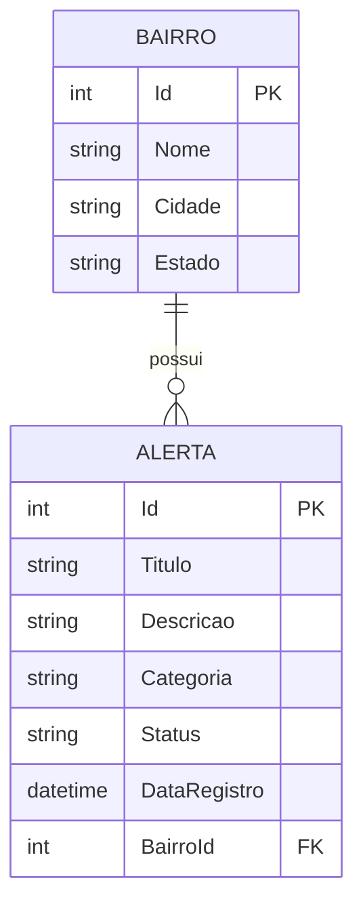

# AlertaBairro

API REST da solução CitizenTech **AlertaBairro**, voltada ao registro de alertas
comunitários associados a bairros.

## Integrantes

- A preencher: nome e RM de cada integrante.

## Tecnologias

- ASP.NET Core 8 Web API com controllers
- Entity Framework Core 8
- Oracle Database
- Migrations do Entity Framework Core

## Modelo de dados



Um bairro pode possuir vários alertas, e cada alerta pertence a um único bairro.

## Pré-requisitos

- .NET 8 SDK
- Acesso ao Oracle da FIAP
- Git

## Configuração da conexão

A aplicação não armazena credenciais no repositório. Configure a connection
string por variável de ambiente.

No PowerShell:

```powershell
$env:ConnectionStrings__Oracle = "User Id=SEU_USUARIO;Password=SUA_SENHA;Data Source=oracle.fiap.com.br:PORTA/SERVICO"
```

Substitua `PORTA` e `SERVICO` pelos dados fornecidos pela FIAP, assim como
usuário e senha. Não envie credenciais ao repositório. A variável
`ORACLE_CONNECTION_STRING` também é aceita.

## Preparar o banco e executar

Na raiz do repositório:

```powershell
dotnet restore AlertaBairro.sln
dotnet build AlertaBairro.sln
dotnet tool restore
dotnet tool run dotnet-ef database update `
  --project src\AlertaBairro.Infrastructure\AlertaBairro.Infrastructure.csproj `
  --startup-project src\AlertaBairro.Api\AlertaBairro.Api.csproj
dotnet run --project src\AlertaBairro.Api\AlertaBairro.Api.csproj --urls http://localhost:5000
```

O comando `database update` aplica a migration e cria as tabelas no Oracle.
As migrations ficam versionadas em:

```text
src\AlertaBairro.Infrastructure\Persistence\Migrations
```

## Rotas

### Bairros

```text
GET    /api/bairros
GET    /api/bairros/{id}
POST   /api/bairros
PUT    /api/bairros/{id}
DELETE /api/bairros/{id}
```

## Verificação manual do CRUD

Com a API em execução e o Oracle configurado, abra outro PowerShell. Os
exemplos a seguir usam os IDs retornados pela API e registram o código HTTP.

Crie um bairro (`201`), liste e consulte (`200`):

```powershell
$base = "http://localhost:5000/api"
$bairro = @{ nome = "Moema"; cidade = "Sao Paulo"; estado = "SP" } | ConvertTo-Json
$resposta = Invoke-WebRequest -Method Post -Uri "$base/bairros" -ContentType "application/json" -Body $bairro -UseBasicParsing
$resposta.StatusCode
$bairroId = ($resposta.Content | ConvertFrom-Json).id
Invoke-WebRequest "$base/bairros" -UseBasicParsing
Invoke-WebRequest "$base/bairros/$bairroId" -UseBasicParsing
```

Crie um alerta relacionado (`201`), liste e consulte (`200`):

```powershell
$alerta = @{
    titulo = "Alagamento"
    descricao = "Rua com ponto de alagamento"
    categoria = "Infraestrutura"
    status = "Aberto"
    bairroId = $bairroId
} | ConvertTo-Json
$resposta = Invoke-WebRequest -Method Post -Uri "$base/alertas" -ContentType "application/json" -Body $alerta -UseBasicParsing
$resposta.StatusCode
$alertaId = ($resposta.Content | ConvertFrom-Json).id
Invoke-WebRequest "$base/alertas" -UseBasicParsing
Invoke-WebRequest "$base/alertas/$alertaId" -UseBasicParsing
```

Altere os dois registros (`204`):

```powershell
$bairroAtualizado = @{ nome = "Moema"; cidade = "Sao Paulo"; estado = "SP" } | ConvertTo-Json
(Invoke-WebRequest -Method Put -Uri "$base/bairros/$bairroId" -ContentType "application/json" -Body $bairroAtualizado -UseBasicParsing).StatusCode
$alertaAtualizado = @{
    titulo = "Alagamento"
    descricao = "Ponto liberado"
    categoria = "Infraestrutura"
    status = "Resolvido"
    bairroId = $bairroId
} | ConvertTo-Json
(Invoke-WebRequest -Method Put -Uri "$base/alertas/$alertaId" -ContentType "application/json" -Body $alertaAtualizado -UseBasicParsing).StatusCode
Invoke-WebRequest "$base/alertas/$alertaId" -UseBasicParsing
```

Verifique no cliente Oracle os registros criados:

```sql
SELECT * FROM "BAIRROS";
SELECT * FROM "ALERTAS";
```

Apague primeiro o alerta e depois o bairro (`204`). Um bairro com alertas
vinculados retorna `409`, para preservar o relacionamento.

```powershell
(Invoke-WebRequest -Method Delete "$base/alertas/$alertaId" -UseBasicParsing).StatusCode
(Invoke-WebRequest -Method Delete "$base/bairros/$bairroId" -UseBasicParsing).StatusCode
```

Para demonstrar erros em JSON, envie um bairro inválido (`400`) e consulte
o ID do bairro já excluído (`404`):

```powershell
curl.exe -i -X POST "$base/bairros" -H "Content-Type: application/json" -d "{}"
curl.exe -i "$base/bairros/$bairroId"
```

Um alerta com `bairroId` inexistente também retorna `404`. Se `dataRegistro`
for omitida na criação, a API usa a data e hora UTC atuais; na alteração, ela
é preservada quando omitida.

### Rotas de alertas

```text
GET    /api/alertas
GET    /api/alertas/{id}
POST   /api/alertas
PUT    /api/alertas/{id}
DELETE /api/alertas/{id}
```
