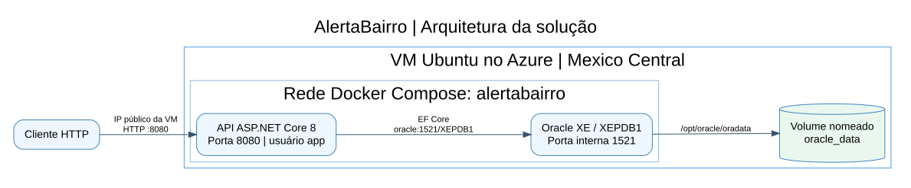

# AlertaBairro · Global Solution 2026/2

O **AlertaBairro** é uma API CitizenTech para registrar e acompanhar alertas comunitários, como alagamentos, associados a bairros. A solução usa **ASP.NET Core 8, Entity Framework Core e Oracle XE**. A API e o banco rodam em containers Docker em uma VM Ubuntu no Microsoft Azure.

**Integrantes e RMs:** 
Mariana de Paula Aguiar - RM566850 / 2TDSPB 
Gustavo Miguel Martins de Oliveira - RM566666 / 2TDSPB 
Manuella Moraes Rodrigues Rinaldi - RM567915 / 2TDSPS
**Vídeo da demonstração:** [AlertaBairro Docker](https://youtu.be/oVS1G1NBJ9o)

## Arquitetura



Um bairro pode ter vários alertas. A chave estrangeira `ALERTAS.BairroId` referencia `BAIRROS.Id`. O Compose aguarda o Oracle passar no *healthcheck* antes de iniciar a API. A porta `8080` é publicada na VM. A porta `1521` é usada dentro da rede Docker.

## Estrutura do projeto

```text
AlertaBairro-Devops/
├── AlertaBairro.sln
├── Dockerfile
├── docker-compose.yml
├── .env.example
├── README.md
├── scripts/
│   └── provision-azure.sh
└── src/
    ├── AlertaBairro.Api/             # Controllers e configuração da API
    ├── AlertaBairro.Application/     # DTOs e validação
    ├── AlertaBairro.Domain/          # Entidades Bairro e Alerta
    └── AlertaBairro.Infrastructure/  # EF Core, Oracle e migrations
```

O Dockerfile compila a API em uma etapa com o SDK .NET 8. A imagem final executa a aplicação com o usuário não-root `app`, no `WORKDIR /app`, e expõe a porta `8080`. O Compose injeta a conexão do banco por meio de `ConnectionStrings__Oracle`.

## Como reproduzir na Azure

### 1. Provisionar a VM com Azure CLI

Abra o **Azure Cloud Shell em Bash**. A VM usa Ubuntu 24.04 x86-64 e o tamanho `Standard_B2s_v2` em **Mexico Central**. A disponibilidade depende da região e da cota da assinatura.

```bash
az account show -o table
az group create --name rg-alertabairro --location mexicocentral

az vm create \
  --resource-group rg-alertabairro \
  --name vm-alertabairro \
  --location mexicocentral \
  --image Canonical:ubuntu-24_04-lts:server:latest \
  --size Standard_B2s_v2 \
  --admin-username azureuser \
  --generate-ssh-keys \
  --public-ip-sku Standard \
  --nsg-rule NONE
```

Para descobrir o IPv4 público do computador que vai testar a API, execute `curl.exe -4 https://api.ipify.org` no **PowerShell do Windows**. Depois, no **Cloud Shell Bash**, rode o bloco abaixo e informe esse IPv4 quando solicitado. A regra de SSH usa o IP de saída do próprio Cloud Shell.

```bash
IP_VM=$(az vm show -d -g rg-alertabairro -n vm-alertabairro --query publicIps -o tsv)
IP_SSH=$(curl -4fsS https://api.ipify.org)
read -r -p "IPv4 público do computador que vai testar a API: " IP_CLIENTE

az network nsg rule create -g rg-alertabairro --nsg-name vm-alertabairroNSG \
  -n AllowSSH --priority 1000 --protocol Tcp \
  --source-address-prefixes "$IP_SSH/32" --destination-port-ranges 22 --access Allow

az network nsg rule create -g rg-alertabairro --nsg-name vm-alertabairroNSG \
  -n AllowAPI --priority 1010 --protocol Tcp \
  --source-address-prefixes "$IP_CLIENTE/32" --destination-port-ranges 8080 --access Allow

echo "IP público da VM: $IP_VM"
ssh azureuser@"$IP_VM"
```

### 2. Instalar Docker e configurar o ambiente

No **terminal SSH da VM**, execute:

```bash
sudo apt-get update
sudo apt-get install -y git docker.io docker-compose-v2
sudo systemctl enable --now docker

git clone https://github.com/marianaaguiar27/AlertaBairro-Devops.git
cd AlertaBairro-Devops
cp .env.example .env
chmod 600 .env
nano .env
```

Preencha `ORACLE_PASSWORD` com a senha do administrador e `APP_DB_PASSWORD` com a senha do usuário `alertabairro`. Use senhas distintas com letras e números. O `.env` é local. O repositório contém apenas o modelo `.env.example`.

### 3. Subir o Oracle, aplicar a migration e iniciar a API

Ainda na VM, na raiz do repositório, execute:

```bash
sudo docker compose config --quiet
sudo docker compose up -d --wait oracle
sudo docker compose build api
sudo docker compose run --rm -e APPLY_MIGRATIONS=true api
sudo docker compose up -d --wait
sudo docker compose ps
curl -i http://localhost:8080/api/bairros
```

A migration cria `BAIRROS` e `ALERTAS`. O último comando deve retornar `200 OK` e, em um banco novo, `[]`.

## Testar o CRUD pelo IP público

No **PowerShell do Windows**, substitua `IP_PUBLICO_DA_VM` pelo IP exibido no provisionamento. Use a mesma sessão até o fim para manter os IDs retornados pela API.

```powershell
$base = 'http://IP_PUBLICO_DA_VM:8080/api'

# Criar o bairro e o alerta (201)
$dadosBairro = @{ nome = 'Vila Mariana'; cidade = 'Sao Paulo'; estado = 'SP' }
$r = Invoke-WebRequest -UseBasicParsing -Method Post -Uri "$base/bairros" -ContentType 'application/json' -Body ($dadosBairro | ConvertTo-Json)
$r.StatusCode
$bairro = $r.Content | ConvertFrom-Json
$bairro

$dadosAlerta = @{
  titulo = 'Alagamento'
  descricao = 'Rua com ponto de alagamento'
  categoria = 'Infraestrutura'
  status = 'Aberto'
  bairroId = $bairro.id
}
$r = Invoke-WebRequest -UseBasicParsing -Method Post -Uri "$base/alertas" -ContentType 'application/json' -Body ($dadosAlerta | ConvertTo-Json)
$r.StatusCode
$alerta = $r.Content | ConvertFrom-Json
$alerta

# Consultar os dois registros (200)
curl.exe -i "$base/bairros/$($bairro.id)"
curl.exe -i "$base/alertas/$($alerta.id)"

# Editar o bairro e o alerta (204)
$dadosBairro.nome = 'Vila Mariana - teste'
$dadosAlerta.status = 'Resolvido'
(Invoke-WebRequest -UseBasicParsing -Method Put -Uri "$base/bairros/$($bairro.id)" -ContentType 'application/json' -Body ($dadosBairro | ConvertTo-Json)).StatusCode
(Invoke-WebRequest -UseBasicParsing -Method Put -Uri "$base/alertas/$($alerta.id)" -ContentType 'application/json' -Body ($dadosAlerta | ConvertTo-Json)).StatusCode
Invoke-RestMethod -Uri "$base/alertas/$($alerta.id)"
```

### Consultar diretamente no Oracle

Antes de excluir os registros, abra o SQL*Plus **no terminal da VM**:

```bash
sudo docker compose exec oracle sqlplus 'alertabairro@//localhost:1521/XEPDB1'
```

Digite a senha `APP_DB_PASSWORD` quando solicitada. No prompt `SQL>`, execute:

```sql
SET LINESIZE 120
COLUMN BAIRRO FORMAT A25
COLUMN ALERTA FORMAT A20
COLUMN STATUS FORMAT A12

SELECT b."Id" AS BAIRRO_ID,
       b."Nome" AS BAIRRO,
       a."Id" AS ALERTA_ID,
       a."Titulo" AS ALERTA,
       a."Status" AS STATUS
FROM "BAIRROS" b
JOIN "ALERTAS" a ON a."BairroId" = b."Id"
WHERE b."Nome" = 'Vila Mariana - teste';
```

O resultado mostra o alerta **Alagamento** com status **Resolvido**, associado a **Vila Mariana - teste**.

### Comprovar a persistência e concluir o CRUD

Digite `EXIT` para sair do SQL*Plus. No **terminal da VM**, recrie os containers preservando o volume. Execute `down` sem a opção `-v`.

```bash
sudo docker compose down
sudo docker compose up -d --wait
sudo docker compose ps
sudo docker volume ls --filter name=oracle_data
```

No **mesmo PowerShell**, consulte o alerta novamente e confira que ele voltou com o mesmo ID e os mesmos dados. Em seguida, exclua primeiro o alerta e depois o bairro.

```powershell
Invoke-RestMethod -Uri "$base/alertas/$($alerta.id)"

# Excluir os registros (204)
curl.exe -i -X DELETE "$base/alertas/$($alerta.id)"
curl.exe -i -X DELETE "$base/bairros/$($bairro.id)"

# Confirmar a exclusão (404)
curl.exe -i "$base/alertas/$($alerta.id)"
curl.exe -i "$base/bairros/$($bairro.id)"
```

## Evidências da demonstração

| Evidência | O que conferir |  |
|---|---|---|
| Arquitetura macro e VM Azure | VM em Mexico Central, script da Azure CLI e diagrama da solução |  |
| Containers em execução | `sudo docker compose ps` mostra a API na porta `8080` e o Oracle `healthy` |  |
| Logs da API e do Oracle | `sudo docker compose logs --tail=15 api oracle` |  |
| Acesso ao container, usuário e diretório | `sudo docker compose exec api sh -c 'id && pwd && ls -la'` mostra o usuário `app` (UID `1654`) e o diretório `/app` |  |
| Estrutura do projeto | Pastas do repositório e arquivos `Dockerfile`, `docker-compose.yml` e `scripts/provision-azure.sh` no VS Code | |
| CRUD funcionando | `POST`, `GET`, `PUT` e `DELETE` do bairro Vila Mariana e do alerta, pelo IP público |  |
| `SELECT` diretamente no banco | SQL*Plus dentro do container Oracle, com `JOIN` entre `BAIRROS` e `ALERTAS` |  |
| Persistência dos dados | Volume `oracle_data` e consulta ao mesmo alerta após recriar os containers |  |


## Uso de I.A. Generativa
Utilizamos o ChatGPT Codex como ferramenta de apoio para identificar e corrigir erros durante o desenvolvimento e organizar as etapas do projeto AlertaBairro. A equipe revisou as sugestões e validou as correções com testes.